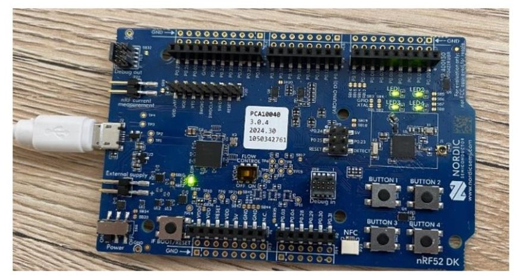
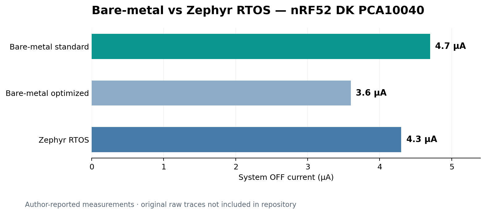

# Low-Power Embedded Firmware — Bare-Metal vs Zephyr RTOS (nRF52 DK)

**Target board:** Nordic **nRF52 DK (PCA10040)** · **nRF52832 XXAA** · ARM Cortex-M4F · 512 KiB Flash · 64 KiB RAM.  
**Tech stack:** Embedded C · nRF5 SDK 17.1.0 · Zephyr RTOS v3.7.0 · DeviceTree · Kconfig · Python.

This repository compares **Bare-metal** and **Zephyr RTOS** firmware with two separate power experiments: **System OFF** (static deep-sleep current) and **System ON Idle** (periodic wake-up and workload). The PCA10040 target matches the board used in the author's original study.



## 1. System OFF — measurements reported by the author

The project author reports obtaining the following current values on an nRF52 DK **PCA10040**:



| Variant | Current in System OFF | Compared with bare-metal standard |
|---|---:|---:|
| Bare-metal standard | **4.7 µA** | Baseline |
| Bare-metal optimized | **3.6 µA** | −23.4% |
| Zephyr RTOS | **4.3 µA** | −8.5% |

Zephyr is **19.4% higher** than the optimized bare-metal value.

**Measurement provenance:** These are **author-reported historical measurements**, not scraped benchmark values. The original LinkedIn chart is preserved in `assets/linkedin_original_chart.png`. The raw instrument traces, measurement instrument details, original binary hashes and full acquisition metadata **are not yet included**. Consequently, these figures have not been independently reproduced using the firmware in this repository. The `system-off/` implementations are a technical reconstruction; their retention configurations are **not asserted** to be identical to the original firmware. See [measurement methodology](docs/system_off_methodology.md) and [validation status](VALIDATION.md).

**Engineering interpretation:** System OFF stops the CPU and RTOS scheduler. Static current differences mainly reflect retained hardware state, GPIO/wake configuration and board-level loads, **not Zephyr scheduler overhead**. System OFF wake-up via GPIO causes a reset; the internal RTC cannot periodically wake the chip in System OFF.

## 2. Source tree

```text
low-power-nrf52-comparison/
├── bare-metal/             # System ON Idle: RTC2 interrupt + WFE
├── zephyr/                 # System ON Idle: k_timer + semaphore
├── system-off/
│   ├── bare-metal/         # Standard vs optimized RAM retention
│   └── zephyr/             # sys_poweroff() with GPIO SENSE wake
├── common/                 # Shared deterministic CPU workload
├── analysis/               # CSV analysis + reported-value summary
├── measurements/           # Data template (raw traces not included)
├── tests/                  # Host-side Python tests
├── docs/                   # Architecture and experimental methodology
├── assets/                 # Board photo, original and regenerated chart
├── VALIDATION.md
└── README.md
```

## 3. Pinout and board mapping (PCA10040)

| Function | nRF52832 pin | Purpose |
|---|---|---|
| BUTTON1 (`sw0`) | **P0.13** | Low-level SENSE, wake from System OFF via reset |
| LED1 (`led0`) | **P0.17** | Active-low optional activity LED |
| Marker | **P0.03** | Oscilloscope / logic analyzer marker (System ON) |
| RTC2 | Internal | Bare-metal periodic System ON wake |

## 4. Build and flash

### System OFF — bare-metal (nRF5 SDK 17.1.0)

Install Nordic nRF5 SDK 17.1.0, ARM GNU toolchain and a supported J-Link flashing tool. From `system-off/bare-metal`:

```bash
make SDK_ROOT=/absolute/path/to/nRF5_SDK_17.1.0 RETAIN_RAM_SECTION0=1
make SDK_ROOT=/absolute/path/to/nRF5_SDK_17.1.0 RETAIN_RAM_SECTION0=0
```

Expected HEX files: `build/retention_1/system_off_bare_metal.hex` and `build/retention_0/system_off_bare_metal.hex`.

### System OFF — Zephyr RTOS v3.7.0

From a configured Zephyr v3.7.0 workspace:

```bash
west build -b nrf52dk/nrf52832 /absolute/path/to/repo/system-off/zephyr -d build/system-off-zephyr
west flash -d build/system-off-zephyr
```

### System ON Idle — separate periodic benchmark

```bash
cd bare-metal
make SDK_ROOT=/absolute/path/to/nRF5_SDK_17.1.0 SCENARIO_LED_ENABLE=0
```

```bash
west build -b nrf52dk/nrf52832 /absolute/path/to/repo/zephyr -d build/zephyr
```

For Zephyr's System ON experiment, set `CONFIG_SCENARIO_LED=n` in `zephyr/prj.conf` to avoid LED current dominating the MCU comparison. Both periodic variants use a nominal 5 s interval, 50 ms optional LED pulse and 4096-iteration shared CPU workload. **System ON Idle results are not the System OFF currents above.**

## 5. Analysis and verification

```bash
python analysis/reference_summary.py
python -m unittest discover -s tests -v
```

The Python tests validate calculations, **not** embedded compilation or real-board measurements. For new raw measurements, use `measurements/template.csv` and `analysis/power_analysis.py` as described in [System ON methodology](docs/methodology.md).

**Firmware validation remains pending:** build, flash, BUTTON1 wake-by-reset, GPIO marker and power profiling must be verified on an actual PCA10040 with the correct board-revision current-measurement circuit. Never connect an ammeter in current mode directly across the supply.

## 6. Documentation

- [System OFF implementation](system-off/README.md)
- [System OFF measurement protocol](docs/system_off_methodology.md)
- [System ON Idle architecture](docs/architecture.md)
- [System ON Idle methodology](docs/methodology.md)
- [Technical report](docs/technical_report.md)
- [Validation checklist](VALIDATION.md)

## References

- [Nordic nRF52 DK product page](https://www.nordicsemi.com/Products/Development-hardware/nRF52-DK)
- [Nordic nRF52832 product specification](https://docs.nordicsemi.com/bundle/ps_nrf52832/page/keyfeatures_html5.html)
- [Zephyr v3.7 documentation](https://docs.zephyrproject.org/3.7.0/)
